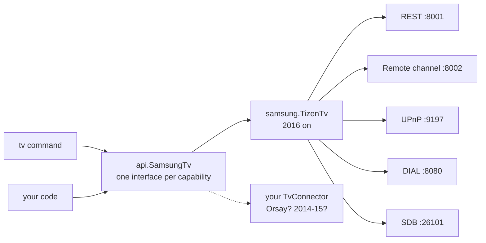

# SamsungTvClient

[](https://github.com/Brendan-Black/SamsungTvClient/actions/workflows/ci.yml)
[](https://jitpack.io/#Brendan-Black/SamsungTvClient)


[](LICENSE)

**Everything a Samsung Smart TV offers over your network, from Java or a single command.**

Press remote keys, open apps, cast a video with subtitles, wake the TV, and install your own apps without Tizen Studio.
It's a library and a `tv` command in pure JDK 25, with no dependencies.

```console
$ tv discover
[TV] Living Room     UN75NU8000   192.168.1.52   Tizen with a token (2017 on, M, N, R, T, A, B, C, D and Q series)

$ tv key home right right ok
Sent KEY_HOME KEY_RIGHT KEY_RIGHT KEY_ENTER.

$ tv cast http://192.168.1.10:8300/film.mkv --subtitles http://192.168.1.10:8300/film.srt
Casting to [TV] Living Room: http://192.168.1.10:8300/film.mkv (subtitles: http://192.168.1.10:8300/film.srt)
Now PLAYING.
```

## What it talks to

| Interface | Port | What it does | Pairing |
|---|---|---|---|
| REST (`samsung.SmartApi`) | 8001 | device info; one app's status, launch, close | no |
| Remote channel (`samsung.RemoteChannel`) | 8002, TLS WebSocket | remote keys, text into the on-screen keyboard, pointer move/click, installed apps, launch an app with a URL or deep link, TV events | yes, once |
| UPnP MediaRenderer (`upnp.Renderer`) | 9197 | play a URL, with subtitles; play, pause, stop, seek, volume, mute | no |
| DIAL (`dial.Dial`) | 8080 | start YouTube or Netflix with something to play; status; stop | no |
| Wake-on-LAN (`net.WakeOnLan`) | UDP 9 | turn the TV on | no |
| Developer connection (`sdb.Sdb`) | 26101 | install, open and remove your own apps; the TV's DUID | Developer Mode, with this PC as Host PC IP |

`samsung.TizenTv` puts them together for one TV, behind the generation-neutral `api.SamsungTv`.

## The `tv` command

```sh
./tv.sh info                     # Windows: tv.bat info
./tv.sh pair                     # choose Allow on the TV, once
./tv.sh key home right right ok
./tv.sh browse http://192.168.1.10:8300/
./tv.sh apps
./tv.sh launch YouTube
./tv.sh dial YouTube launch v=dQw4w9WgXcQ
./tv.sh volume 20
./tv.sh cast http://192.168.1.10:8300/film.mkv --subtitles http://192.168.1.10:8300/film.srt
./tv.sh --ip 192.168.1.52 wake
```

Or, without building, the jar from [Releases](https://github.com/Brendan-Black/SamsungTvClient/releases):
`java -jar SamsungTvClient-<version>.jar info`.

`./tv.sh` with no arguments lists every command. Without `--ip` (or `SAMSUNGTV_IP`), it uses the only Samsung TV discovery
finds. Pairings are kept in `~/.samsungtv/tvs.properties` (`--store` to change): the token, the fingerprint of the TV's
certificate, and its MAC address for `wake`.

Needs JDK 25. `tv.sh` and `tv.bat` build with the Gradle wrapper first.

## As a library

Releases are on [JitPack](https://jitpack.io/#Brendan-Black/SamsungTvClient). In `build.gradle.kts`:

```kotlin
repositories {
    mavenCentral()
    maven("https://jitpack.io")
}

dependencies {
    implementation("com.github.Brendan-Black:SamsungTvClient:1.0.0")
}
```

```java
Host host = new Host("192.168.1.52");
Generation generation = new PortProbe().detect(host).orElseThrow();

try (SamsungTv tv = Connectors.builtIn().connect(host, generation, "My App", TvStore.defaultStore())) {
    tv.remote().key(Key.HOME.code());

    if (tv.supports(Capability.APPS)) {
        tv.apps().browse(new HttpUrl("https://example.com/"));
    }

    tv.media().cast(Media.of(new HttpUrl("http://192.168.1.10:8300/film.mkv"))
        .titled("The Film")
        .subtitled(new HttpUrl("http://192.168.1.10:8300/film.srt")));
}
```

The types carry what they know. A `Host`, an `AppId` or a `KeyCode` can't exist with a bad value, so there's nothing to
re-check and arguments can't be swapped. What may be missing is an `Optional` or says `@Nullable`, and a failure is an
exception that says what was attempted. `upnp.Renderer` on its own casts to any UPnP MediaRenderer, whoever made it.

## Generations

Samsung has changed its TVs' network API several times. `api.Generation` lists them, and `tv generations` prints the list:

| Generation | Years | Series | Protocol | Here |
|---|---|---|---|---|
| `orsay` | 2010-2013 | C, D, E, F | remote over TCP 55000 (base64 packets); Allow on the TV | not implemented |
| `encrypted` | 2014-2015 | H, J | PIN pairing over HTTP 8080, then an AES-encrypted Socket.IO remote on 8000 | not implemented |
| `tizen-open` | 2016 | K | REST and a plain WebSocket remote channel, both on 8001; no token | implemented, untested |
| `tizen-token` | 2017 on | M, N, R, T, A, B, C, D, Q | REST on 8001, a TLS WebSocket remote channel on 8002 with a token | tried on a UN75NU8000 |

The UPnP MediaRenderer (`cast`, `volume`) is the same in every generation, so those commands work on any Samsung TV from
2011 on, and on other makers' renderers too.

Each thing a TV can do is its own interface: `RemoteControl`, `TextInput`, `Pointer`, `Events`, `Apps`, `DialApps`,
`MediaPlayer`, `Volume`, `Developer`, `Pairing`, `About`. `SamsungTv.capabilities()` says which ones a TV has. Asking for one
it doesn't have throws `UnsupportedCapabilityException`, and the message says whether the generation lacks it or this
library does.



**Adding a generation.** Write a `TvConnector` that makes your `SamsungTv`. It overrides only the capabilities its protocol
has, because the rest default to "unsupported". Then add it with `Connectors.builtIn().with(new MyConnector())`.
`samsung.TizenTv` and `samsung.TizenConnector` show the pattern, and the description of each generation in `api.Generation`
gives the protocol details to start from. If you own a 2010-2015 set, this is the most useful contribution there is.

## Subtitles

`tv cast <video url> --subtitles <subtitle url>` (or `Media.subtitled` in the library) plays a video with an external
subtitle file: `.srt`, `.smi`, `.sub`, `.ssa`, `.ass`, `.vtt` or `.ttml`, by extension (anything else is sent as SRT). The TV
fetches the file itself, so it has to be on an http(s) server the TV can reach, like the video. `upnp.Didl` puts it in the
DIDL-Lite the way Samsung TVs read it: `sec:CaptionInfoEx` and `sec:CaptionInfo` (namespace `http://www.sec.co.kr/`,
`sec:type` the format), plus a second `res` with `smi/caption`. Renderers from other makers ignore these. Some Samsung models
also ask the video's server for a `CaptionInfo.sec` response header (they send `getCaptionInfo.sec: 1`); a server you control
can answer it with the subtitle URL too.

## Your own apps, without Tizen Studio

An installed web app gets the remote's keys (arrows, OK, Back) as `keydown` events, which the TV's browser turns into a
pointer. `tv` does what Tizen Studio would, in plain Java:

1. **Developer Mode.** On the TV: Apps, then 1 2 3 4 5 (`tv key 1 2 3 4 5` works too). Turn it on, set Host PC IP to this PC's
   address on the TV's network, and restart the TV by holding Power. `tv info` shows `Developer: on`.
2. **`tv certificate`** signs in to your Samsung account in the browser (the password goes only to Samsung) and gets an author
   certificate and a distributor certificate for this TV's DUID from Samsung's certificate service, as Certificate Manager does
   (`tizen.SamsungCertificates`, from the Samsung Certificate Extension 2.0.75). They're kept in `~/.samsungtv/samsung`.
   **Back up `author.p12` and `password`**: the TV only takes an update to an app signed by the author certificate that
   installed it.
3. **`tv install <folder>`** signs the folder (`tizen.WidgetSigner`: the W3C widget signatures Samsung's packager writes), copies
   it to the TV over SDB, installs it with `0 vd_appinstall`, and opens it. `tv package` only signs.

Which distributor certificate: Samsung changed its certificate authorities in 2025. TVs on Tizen 4.0 and older, like the
UN75NU8000, reject Samsung's new distributor certificates (install failed 118012, "invalid certificate chain"), even after Device
Manager's "permit to install". They accept the public distributor certificate that ships with Tizen Studio
(`tizen.TizenDistributor`; it expired in 2022, which these TVs don't check). Samsung's author certificate is fine on them: it
chains to a 2013 Tizen root. `tv install` reads the TV's version and picks.

Writing the app: Tizen 4.0's engine is Chrome 56. There's no CSS Grid (Chrome 57) or `justify-content: space-evenly` (Chrome 60);
use flexbox. The page is 1920x1080. Back is key code 10009.

## What's been tried on a real TV

On a 2018 UN75NU8000 (Tizen 4.0): device info, pairing, keys, the app list, launch, browse, and the whole app path (certificates,
signing, install, open).

Not yet tried on a TV: REST app close, DIAL, text entry, pointer moves, Wake-on-LAN, and subtitles. The tests cover them against
pseudo TVs that follow Samsung's protocols. **If you've got a different model, a
[TV report](https://github.com/Brendan-Black/SamsungTvClient/issues/new?template=tv-report.yml) saying what worked is very
welcome.**

<details>
<summary>Notes from the UN75NU8000</summary>

- Port 8001's remote channel answers `ms.channel.unauthorized` (this model wants pairing over 8002). The REST device info on
  8001 works without pairing.
- Its certificate is self-signed and names no host, so the client pins it the first time (as SSH does) instead of checking a
  host name.
- `org.tizen.browser` launches with `NATIVE_LAUNCH` and a URL in `metaTag`. Its browser is Chrome 56 (`SamsungBrowser/2.1`) and
  shows pages at 1536x748. The remote's arrows move a pointer there, and OK clicks: pages get `click` events, not arrow-key events.
- Wake-on-LAN needs Settings > General > Network > Expert Settings > Power On with Mobile.
- REST app status reports a sideloaded app as "not running" even while it's on screen.

</details>

## Tests

`./gradlew check` needs no TV and no network. It runs unit checks and strict stand-ins, which fail the run on any request no
TV would be sent:

- `PseudoSamsung`, in process: the REST API, DIAL, and the remote channel as a real WebSocket server that pairs (Allow and
  Deny), sends replies in fragments, and records what it receives.
- `PseudoSdb`, in process: the developer connection, which hangs up on a bad checksum as sdbd does, takes pushes, and answers
  Samsung's install commands.
- `PseudoHttp`, in process: canned replies, including every malformed and refused one a TV or Samsung's certificate service
  can give.
- `test/PseudoTv.java`, a separate process: a UPnP MediaRenderer with a running clock and SSDP. It runs on its own too:
  `java test/PseudoTv.java`, then `./tv.sh --ip 127.0.0.1 status`.

`./gradlew smoke` tries SSDP discovery over real multicast. It's kept out of `check` because the result depends on the machine.

## Built to a standard

The code follows [Black Java](https://github.com/Brendan-Black/black-java). The build enforces it: `check` fails on unformatted
code, on compiler warnings, and (with NullAway, at build time only) on a null that isn't announced. See
[CONTRIBUTING.md](CONTRIBUTING.md).

## Security

Pairing tokens and signing keys live on your disk, readable only by you. See [SECURITY.md](SECURITY.md), including how to
report a problem.

This project isn't affiliated with or endorsed by Samsung.

## License

[MIT](LICENSE)
